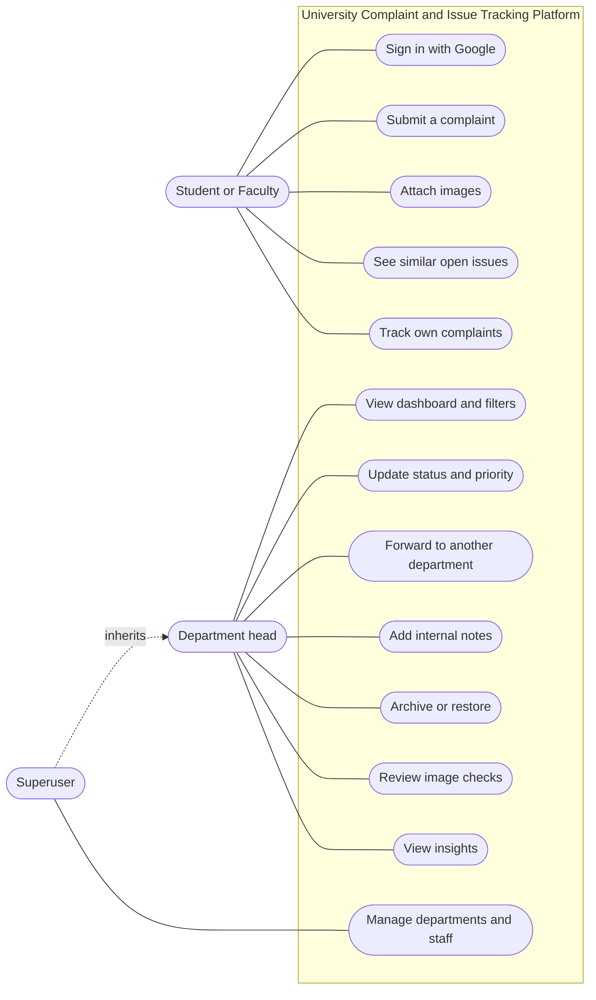
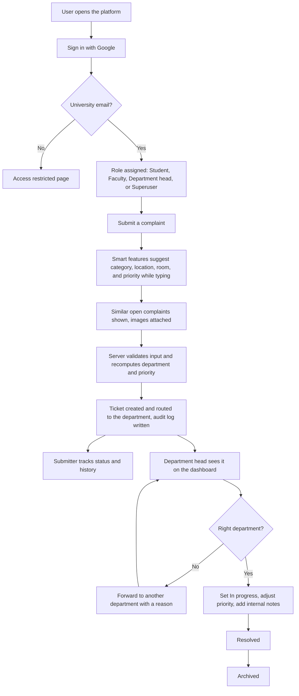
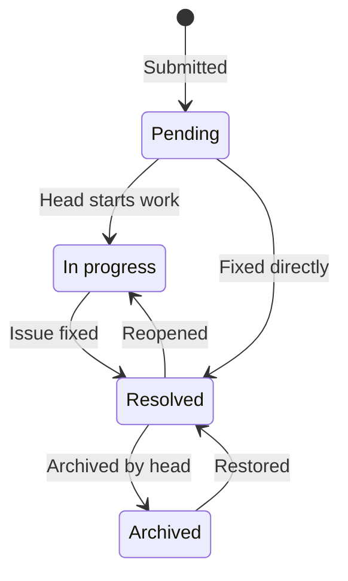
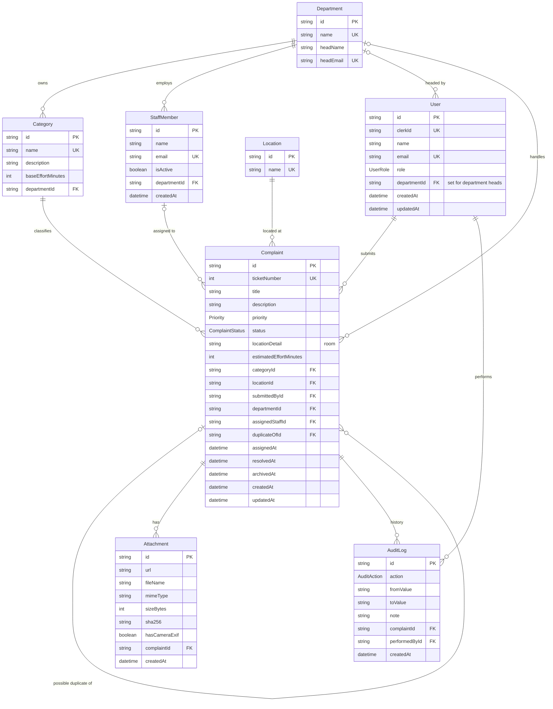
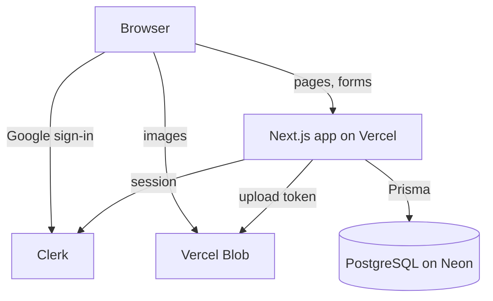

# University Complaint and Issue Tracking Platform

A web platform where students and faculty report campus issues, and the responsible department tracks and resolves them. Complaints are routed to the right department automatically, prioritized automatically, and every change is recorded in an audit trail.

**Live app:** https://university-issue-tracker.vercel.app

**Project board:** https://github.com/users/DanialZahid/projects/2

> Sign-in is limited to university Google accounts (`@iqra.edu.pk`). Other accounts are shown an "Access restricted" page.

---

## Contents

- [Problem](#problem)
- [Features](#features)
- [Smart features](#smart-features)
- [Roles](#roles)
- [Pages](#pages)
- [Design documents](#design-documents)
- [Use cases](#use-cases)
- [Business flow](#business-flow)
- [Complaint lifecycle](#complaint-lifecycle)
- [Database schema (ERD)](#database-schema-erd)
- [Architecture](#architecture)
- [Technology stack](#technology-stack)
- [Project structure](#project-structure)
- [Running locally](#running-locally)
- [Sprints](#sprints)
- [Roadmap](#roadmap)
- [License](#license)

---

## Problem

Campus issues (a broken AC, a projector that doesn't work, a timetable clash) are usually reported verbally or on paper. Nobody knows who is responsible, whether the issue was already reported, or whether anything happened after reporting it. This platform gives every complaint a ticket, sends it to the department that handles it, and lets the submitter follow its progress.

## Features

### For students and faculty

- Sign in with the university Google account.
- Submit a complaint with a title, description, category, location, and room. Category, location, room, and priority are filled in from the text while typing. Location is optional for website, online, or campus-wide issues.
- Similar open complaints from the same place and category are shown while typing, so an issue that is already reported can be spotted before submitting.
- Attach up to three images. They are compressed in the browser before upload.
- Ticket number for every complaint (for example `CMP-00042`).
- "My complaints" list with status and priority badges, filters, and a card, table, or compact view.
- Complaint detail page with images and a status history.

### For department heads and the superuser

- Department dashboard scoped to the head's own department (the superuser sees all departments).
- Stat cards (Pending, In progress, Resolved, and Critical and open) that double as filters.
- Live search (ticket number included), filters for status, priority, category, location, department, and date range, active filter chips, sortable columns, and pagination. All filter state lives in the URL, so a filtered view can be bookmarked or shared.
- Complaint management page: change status and priority, forward to another department with an internal reason, add internal notes, and archive resolved complaints or restore them.
- Attached images with automated checks: camera data, and links to other complaints that use the same image.
- Insights page: open work, complaints submitted and resolved per day over the last 30 days, and open complaints by category and location.
- Full audit trail: who changed what, when, and from which value to which.
- Conflict check: if two managers act on the same complaint, the second change is rejected with a "refresh and try again" message instead of silently overwriting the first.

## Smart features

The platform reads what the submitter writes and fills in the rest. Suggestions appear live while typing, and the submitter can still adjust category, location, and room.

| Feature             | What it does                                                                                                                                                                    |
| ------------------- | ------------------------------------------------------------------------------------------------------------------------------------------------------------------------------- |
| Category            | Suggested from the title and description. The title counts more than the description.                                                                                           |
| Emergency detection | Reports describing an emergency (fire, smoke, a gas leak, an injury) are flagged as Safety automatically.                                                                       |
| Department routing  | The department comes from the category. Submitters never pick a department.                                                                                                     |
| Priority            | Set from how urgent the report reads, how many people it affects, and its category. Submitters don't choose it; department heads can change it.                                 |
| Room                | Recognized in campus formats and normalized, so `ac103` or `room 103` becomes `AC-103`, and `lab 4` becomes `C-Lab 04`.                                                         |
| Location            | Recognized from building names and common nicknames (canteen, gate, admin building, computer lab). Left empty, it is saved as "No specific place".                              |
| Similar issues      | Open complaints that look like the one being typed are shown beside the form (see the rule below).                                                                              |
| Image checks        | Each image is fingerprinted (SHA-256) and checked for camera data. Managers see whether a photo came from a camera and whether the same image is attached to another complaint. |

The same logic runs in the browser for live suggestions and on the server for the final values, so department and priority can't be changed from the browser.

### Similar issues: matching rule

Only open complaints (Pending or In progress) in the **same category and location**, not archived, and submitted in the **last 30 days** are compared.

| Step      | Rule                                                                                                                           |
| --------- | ------------------------------------------------------------------------------------------------------------------------------ |
| Words     | Titles are split into words. Filler words (the, is, in, not) and numbers are dropped, and plurals are folded (chairs = chair). |
| Overlap   | Shared words divided by the word count of the shorter title.                                                                   |
| Same room | Adds 0.3 when both name the same room.                                                                                         |
| Match     | A score of 0.5 or more. The top three are shown, checked once typing pauses.                                                   |

| New title                  | Existing open complaint     | Result        |
| -------------------------- | --------------------------- | ------------- |
| AC not cooling in AC-103   | AC is not cooling (AC-103)  | Match         |
| Broken chairs in classroom | Chair broken                | Match         |
| AC not cooling             | Fan not working             | No match      |
| Whiteboard marker missing  | Fan not working (same room) | 0.3, no match |

Safety complaints are never shown to other users. Others see only the title, status, room, and age.

## Roles

| Role            | Access                                    |
| --------------- | ----------------------------------------- |
| Student         | Submit and track own complaints           |
| Faculty         | Same as Student                           |
| Department head | Manage complaints of their own department |
| Superuser       | Manage all complaints and departments     |

Identity comes from the university's Google accounts. Roles are assigned inside the platform: department heads are matched by the head email stored on each department, and the superuser is set in server configuration.

## Pages

| #   | Page                  | Route                          | Status                         |
| --- | --------------------- | ------------------------------ | ------------------------------ |
| 1   | Sign in               | `/sign-in`                     | Done                           |
| 2   | Access restricted     | `/access-restricted`           | Done                           |
| 3   | My complaints         | `/complaints`                  | Done                           |
| 4   | Submit a complaint    | `/complaints/new`              | Done                           |
| 5   | Complaint detail      | `/complaints/CMP-xxxxx`        | Done                           |
| 6   | Department dashboard  | `/manage`                      | Done                           |
| 7   | Complaint management  | `/manage/complaints/CMP-xxxxx` | Done                           |
| 8   | Departments and staff | `/manage/departments`          | Planned                        |
| 9   | Insights and reports  | `/manage/insights`             | Insights done, reports planned |

## Design documents

The diagrams below are written in Mermaid and render on GitHub. The same diagrams are also saved as images, along with the wireframes, in case Mermaid does not load.

| Document                                       | File                                                                                            |
| ---------------------------------------------- | ----------------------------------------------------------------------------------------------- |
| Use cases                                      | [docs/diagrams/use-cases.png](docs/diagrams/use-cases.png)                                      |
| Business flow                                  | [docs/diagrams/business-flow.png](docs/diagrams/business-flow.png)                              |
| Complaint lifecycle                            | [docs/diagrams/complaint-lifecycle.png](docs/diagrams/complaint-lifecycle.png)                  |
| Database schema (ERD)                          | [docs/diagrams/erd.png](docs/diagrams/erd.png)                                                  |
| Database schema, keys and relationships only   | [docs/diagrams/erd-keys.png](docs/diagrams/erd-keys.png)                                        |
| Architecture                                   | [docs/diagrams/architecture.png](docs/diagrams/architecture.png)                                |
| Wireframes (all pages, including planned ones) | [docs/wireframes.pdf](docs/wireframes.pdf)                                                      |
| Wireframes, editable (Excalidraw)              | [Open in Excalidraw](https://excalidraw.com/#json=lqI_9PrXne-Kxs84WJ54m,MohwG_GjP2L7FZWyO9-vdQ) |

## Use cases



Department heads and the superuser can also submit and track their own complaints. The superuser does everything a department head does, across all departments.

## Business flow



## Complaint lifecycle



## Database schema (ERD)

PostgreSQL, managed with Prisma. Schema files are in `prisma/`.



### Fixed values

| Type             | Values                                                                                |
| ---------------- | ------------------------------------------------------------------------------------- |
| User role        | Student, Faculty, Department head, Superuser                                          |
| Complaint status | Pending, In progress, Resolved                                                        |
| Priority         | Low, Medium, High, Critical                                                           |
| Audit action     | Created, Status changed, Priority changed, Assigned, Note added, Archived, Unarchived |

Images are stored in Vercel Blob. The `Attachment` table keeps each image's address, size, fingerprint, and camera flag.

## Architecture



Smart features run in two places: in the browser for live suggestions, and in the server actions for the values that are saved.

## Technology stack

| Layer          | Technology                                       |
| -------------- | ------------------------------------------------ |
| Framework      | Next.js 16 (App Router), React 19, TypeScript    |
| Styling and UI | Tailwind CSS v4, shadcn/ui (Radix), Lucide icons |
| Database       | PostgreSQL on Neon                               |
| ORM            | Prisma 7                                         |
| Authentication | Clerk (Google sign-in, university accounts only) |
| Image storage  | Vercel Blob                                      |
| Validation     | Zod                                              |
| Hosting        | Vercel                                           |

## Project structure

| Folder            | Contents                                                                                   |
| ----------------- | ------------------------------------------------------------------------------------------ |
| `docs/`           | Diagram images and wireframes                                                              |
| `prisma/`         | Database schema (split into files) and migrations                                          |
| `scripts/`        | Reference data, synthetic demo data, and cleanup scripts                                   |
| `src/actions/`    | Server actions for submitting and managing complaints                                      |
| `src/app/`        | Pages and routes (App Router), including the image upload route                            |
| `src/automation/` | Smart features: category, priority, room, location, department routing, and similar issues |
| `src/db/`         | Database queries                                                                           |
| `src/schemas/`    | Input validation                                                                           |
| `src/ui/common/`  | Base UI components                                                                         |
| `src/ui/shared/`  | Complaint, department, and layout components                                               |
| `src/ui/manage/`  | Department dashboard and management components                                             |
| `src/utils/`      | Helpers for dates, tickets, roles, sign-in rules, and image preparation                    |
| `src/proxy.ts`    | Authentication middleware                                                                  |

## Running locally

Requirements: Node.js 24, a PostgreSQL database (Neon works), a Clerk application with Google sign-in, and a Vercel Blob store (public).

1. Clone the repository and install dependencies:
   ```bash
   npm install
   ```
2. Create a `.env` file with these variables:

   | Variable                                       | Purpose                                             |
   | ---------------------------------------------- | --------------------------------------------------- |
   | `DATABASE_URL`                                 | Direct database connection (Prisma CLI and scripts) |
   | `DATABASE_URL_POOLED`                          | Pooled database connection (app)                    |
   | `CHECKPOINT_DISABLE`                           | `1` (turns off Prisma CLI telemetry)                |
   | `NEXT_PUBLIC_CLERK_PUBLISHABLE_KEY`            | Clerk publishable key                               |
   | `CLERK_SECRET_KEY`                             | Clerk secret key                                    |
   | `NEXT_PUBLIC_CLERK_TELEMETRY_DISABLED`         | `1` (turns off Clerk telemetry)                     |
   | `NEXT_PUBLIC_CLERK_SIGN_IN_URL`                | `/sign-in`                                          |
   | `NEXT_PUBLIC_CLERK_SIGN_UP_URL`                | `/sign-in`                                          |
   | `NEXT_PUBLIC_CLERK_SIGN_IN_FORCE_REDIRECT_URL` | `/auth/continue`                                    |
   | `NEXT_PUBLIC_CLERK_SIGN_UP_FORCE_REDIRECT_URL` | `/auth/continue`                                    |
   | `UNIVERSITY_EMAIL_DOMAIN`                      | Allowed email domain, for example `iqra.edu.pk`     |
   | `SUPERUSER_EMAILS`                             | Comma-separated superuser emails                    |
   | `BLOB_READ_WRITE_TOKEN`                        | Vercel Blob token for image uploads                 |

3. Apply migrations, generate the client, and load reference data:
   ```bash
   npm run db:migrate
   npm run db:generate
   npm run db:seed
   ```
4. Optional: load synthetic demo data (default 10,000 complaints over 180 days):
   ```bash
   npm run db:seed:demo -- --count 5000
   ```
   Remove it again with `npm run db:seed:clear` (only synthetic rows are deleted).
5. Start the app:
   ```bash
   npm run dev
   ```

## Sprints

Work is planned in eight two-week sprints. Live progress, issues, and dates are on the [project board](https://github.com/users/DanialZahid/projects/2).

| Sprint | Weeks    | Goal                               |
| ------ | -------- | ---------------------------------- |
| 1      | 1 to 2   | Project setup and authentication   |
| 2      | 3 to 4   | Complaint submission and tracking  |
| 3      | 5 to 6   | Department dashboard               |
| 4      | 7 to 8   | Notifications and smart assignment |
| 5      | 9 to 10  | Image checks and insights          |
| 6      | 11 to 12 | AI-assisted features               |
| 7      | 13 to 14 | Testing and refinement             |
| 8      | 15 to 16 | Documentation and final delivery   |

## Roadmap

| Feature                                                               | Status  |
| --------------------------------------------------------------------- | ------- |
| Similar open issues shown while typing a complaint                    | Done    |
| Image attachments with camera data and reused-image checks            | Done    |
| Insights page                                                         | Done    |
| Possible duplicates flagged on the complaint management page          | Planned |
| More image checks (file details and content)                          | Planned |
| Campus issue board: open issues visible to everyone signed in         | Planned |
| "Affected too" votes with automatic priority escalation               | Planned |
| Submitter updates, withdrawal, and replies visible to the submitter   | Planned |
| Request more information from the submitter                           | Planned |
| Departments, staff, categories, and roles management (superuser)      | Planned |
| Email notifications                                                   | Planned |
| Staff workload and least-loaded assignment                            | Planned |
| AI-assisted description drafting and category and priority suggestion | Planned |
| Reports and summaries                                                 | Planned |

## License

© 2026 Danial Zahid. All rights reserved. The code is public for academic review only. See [LICENSE](LICENSE).
